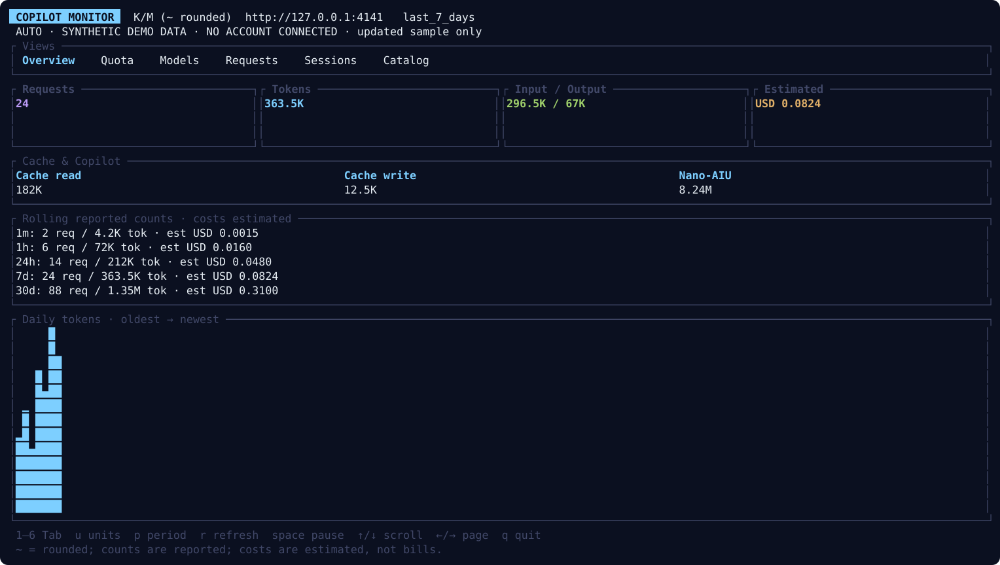

# Copilot API Rust

A Rust implementation intended to be compatible with a **limited scope** of
[`caozhiyuan/copilot-api`](https://github.com/caozhiyuan/copilot-api). It is not
a complete port or a drop-in replacement: provider routing, many translations,
WebSockets, administration, plugins, and desktop features are not implemented.
See [the compatibility notes](rust/README.md#current-scope-and-known-gaps)
before using it.

[](docs/monitor-gallery.md)

[View the screenshot gallery of all six monitor panes](docs/monitor-gallery.md) · synthetic sample data

## Build and run

```fish
cargo build --locked --release --manifest-path rust/Cargo.toml
./rust/target/release/copilot-api-rust auth
./rust/target/release/copilot-api-rust monitor
```

The monitor starts the API server and terminal dashboard together. The server
listens on `127.0.0.1:4141` by default. GitHub device sign-in stores credentials
in the user data directory; alternatively set `COPILOT_API_GITHUB_TOKEN`.
An active GitHub Copilot entitlement is required. Protect credentials and
usage data; do not expose the service to an untrusted network.

The API currently provides `/models`, `/chat/completions`, `/embeddings`,
`/responses` and `/v1` aliases, plus native `/v1/messages`. There is no
gateway-level request-size cap: valid JSON is buffered for inspection and then
forwarded, allowing Copilot to decide whether it is too large. Large requests
can therefore consume substantial local RAM. Individual models may not support
every route. The bundled HTTP usage viewer and terminal monitor cover the Rust
server's reported usage only.

For all current usage, quota, catalog, security, and compatibility details, see
the [Rust implementation guide](rust/README.md). User requirements and scope
decisions are recorded in [the port specification](docs/RUST_PORT_SPEC.md).
