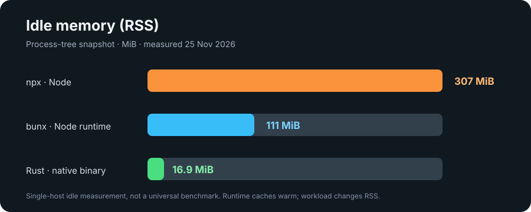
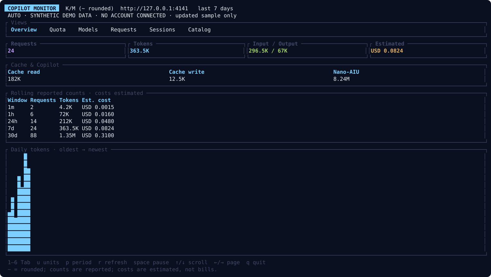

# Copilot API Rust

A Rust implementation intended to be compatible with a **limited scope** of
[`caozhiyuan/copilot-api`](https://github.com/caozhiyuan/copilot-api). It is not
a complete port or a drop-in replacement: provider routing, many translations,
administration, plugins, and desktop features are not implemented. Responses
WebSockets are available behind an opt-in flag.
See [the compatibility notes](RUST_GUIDE.md#current-scope-and-known-gaps)
before using it.



## Measured idle memory

On 2026-11-25, this host measured the launcher's process-tree RSS after the
same upstream `@jeffreycao/copilot-api@2.9.16` package (or the Rust binary) had
been idle for three seconds on an isolated port:

These are single-host, idle snapshot measurements, not a universal benchmark;
`bunx` still launched the package through its Node shebang on this machine.
RSS is summed across each launcher process group, and package/runtime caches
were warm. Large request bodies and concurrent traffic can raise any result.

[](docs/monitor-gallery.md)

[View the screenshot gallery of all six monitor panes](docs/monitor-gallery.md) · overview is a saved live capture; other panes use synthetic data

## What this provides from Copilot API

- GitHub Copilot device sign-in, token reuse, and token refresh.
- A basic proxy for `/models`, `/chat/completions`, `/embeddings`, and `/responses`, with `/v1` aliases, plus native `/v1/messages` pass-through. Upstream status codes and bodies are forwarded; response and SSE bodies are streamed. Model/route support depends on Copilot.
- Opt-in Responses WebSocket transport on `/responses` and `/v1/responses`.
  Run `serve --responses-websockets` (or set
  `COPILOT_API_RESPONSES_WEBSOCKETS=true`) and set the Codex provider's
  `supports_websockets = true`. The same sanitizer and usage accounting are
  used as HTTP; WebSocket traffic is one active request per connection and is
  relayed directly from Codex to GitHub Copilot.
- Local usage monitoring through both an HTTP viewer and a terminal dashboard. The monitor includes request, token, model, session, quota, and catalog views; reported usage is stored locally in SQLite and cost figures are estimates, not bills. The quota view estimates time to zero after observing a recent drop in GitHub-reported remaining balance; resets or usage changes can shift the estimate.
- A model catalog fetched from Copilot’s `/models` endpoint, with name filtering, price sorting, and separately identified GitHub reference prices.
- Automatic Codex catalog refresh at API startup, plus a CLI command (`update-codex-models`) and monitor action (`c`) for manual refresh. It builds and validates Codex's model catalog from models the local gateway currently serves, preserves exact IDs, disambiguates repeated display names with the model ID, sorts GPT models first by descending version, excludes embeddings and non-text outputs, and makes no inference requests. `--activate` updates Codex's `model_catalog_json` setting when needed.
- Experimental Fusion pass-through under `/experimental/fusion/*` for the model catalog, task list/create/detail/events, and environment detail/connect routes. Task creation is an explicit POST and requires `COPILOT_API_KEY`; this undocumented API has unverified task-route authentication and no verified Standard/High/Max effort mapping.

This is the basic Copilot-focused subset currently implemented; it does not provide the original project's complete feature set.

## Build and run

Install the published crate:

```fish
cargo install copilot-api-rust
```

GitHub releases publish the corresponding crate version to crates.io after
the release workflow passes formatting, tests, Clippy, and packaging checks.

To build from this repository instead:

```fish
cargo build --locked --release
./target/release/copilot-api-rust auth
./target/release/copilot-api-rust monitor
```

The monitor opens the terminal dashboard and reuses a matching server if one
is already running; otherwise it starts its own. The server listens on
`127.0.0.1:4141` by default. GitHub device sign-in stores credentials
in the user data directory; alternatively set `COPILOT_API_GITHUB_TOKEN`.
An active GitHub Copilot entitlement is required. Protect credentials and
usage data; do not expose the service to an untrusted network.

When a matching server is already running, `monitor` attaches to it instead of
trying to bind a second listener. Quitting an attached dashboard leaves that
server running; a server started by `monitor` itself is stopped when its
dashboard exits. See the [user service setup](RUST_GUIDE.md#systemd-user-service)
to start the API automatically at login.

With the API running, use `./target/release/copilot-api-rust update-codex-models`
to refresh the local Codex catalog from `/models`. Add `--activate` if Codex's
`model_catalog_json` setting does not already point to the generated catalog.
In the monitor, press `c` to refresh and activate it. The refresh validates the
catalog with the installed Codex CLI and does not send prompts; restart an
already-running Codex session to load its new picker list.

## Why Rust, and memory use

Rust was chosen partly to reduce runtime overhead and give tighter control of
allocations with a compiled executable. The measured idle comparison above
shows the current result on this host, but remains sensitive to runtime,
package version, workload and operating-system accounting.

Responses are streamed instead of collected into one buffer. Request JSON is
still buffered, parsed, and normalized before forwarding. There is no
gateway-level request-size cap, so Copilot decides whether valid JSON is too
large; a large or concurrent request can still consume substantial local RAM.

For all current usage, quota, catalog, security, and compatibility details, see
the [Rust implementation guide](RUST_GUIDE.md). User requirements and scope
decisions are recorded in [the port specification](docs/RUST_PORT_SPEC.md).
