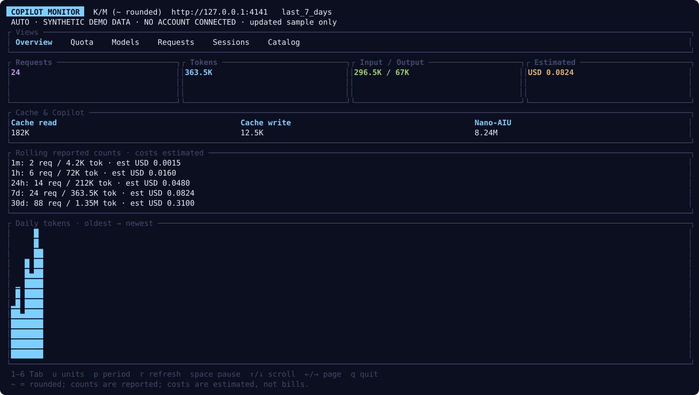
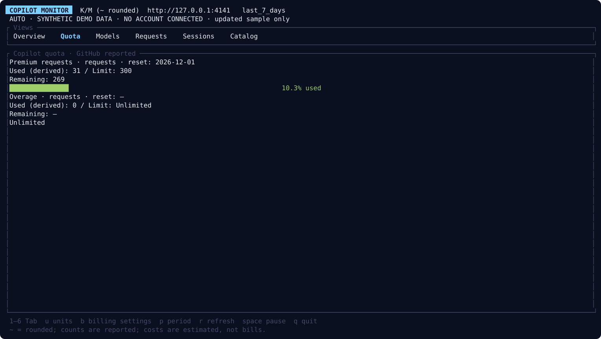
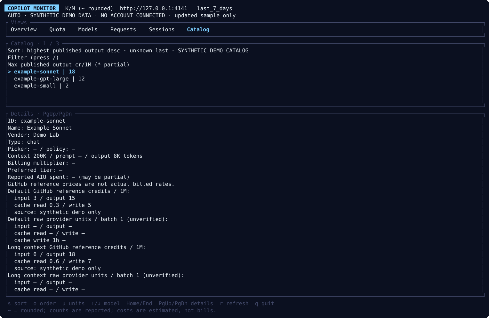

# Terminal monitor screenshot gallery

These images render the actual Ratatui monitor UI with **synthetic sample data**. They were generated from a local `TestBackend` fixture; they are not screenshots of a signed-in account. No GitHub quota, private usage history, credentials, or live API responses are shown.

The preview in the [repository README](../README.md) links here. Panes are rendered at 150 × 38 terminal cells; Catalog uses 150 × 44 so the long-context prices are visible. The status line marks the data as synthetic.

Overview, Models, and Sessions summarize 24 synthetic usage events. The Requests image shows only three illustrative recent rows to keep the view legible; those visible rows are not the complete source for the aggregate totals.

## Overview

## Quota

## Models

## Requests

## Sessions

## Catalog

