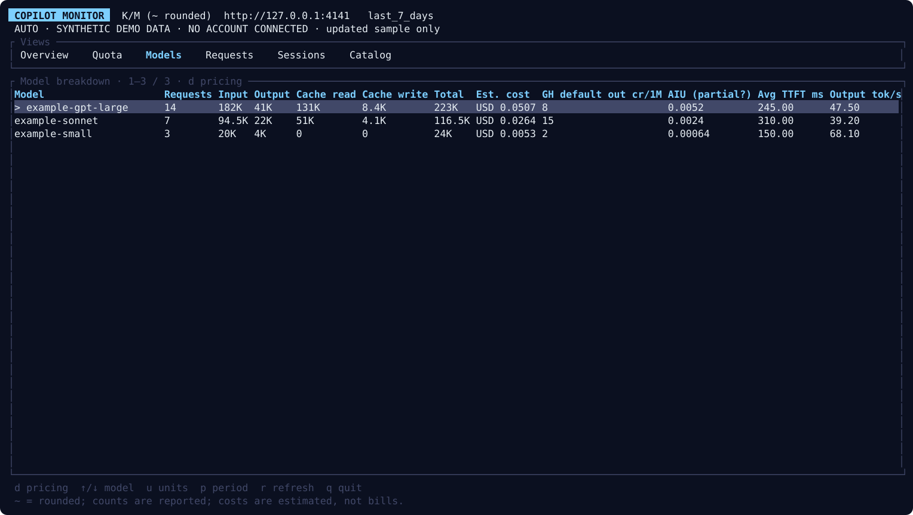
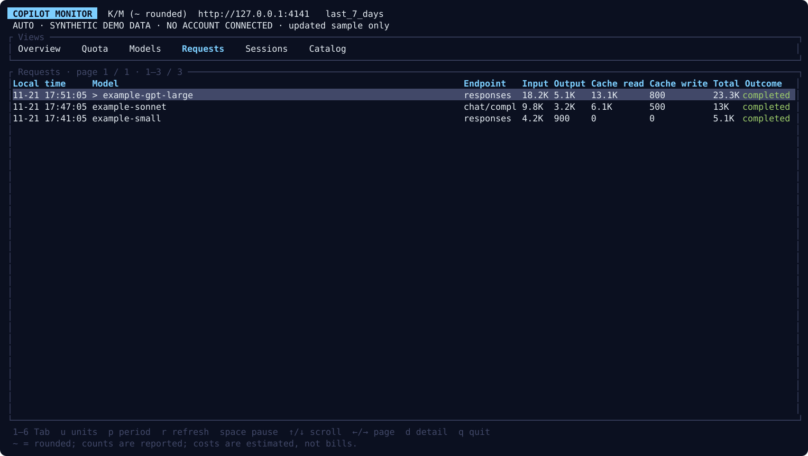
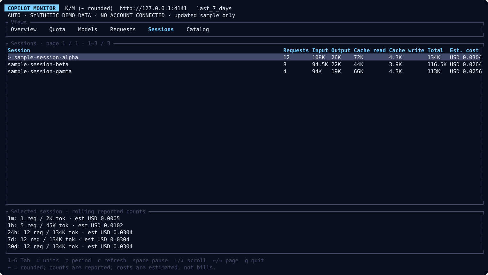

# Terminal monitor screenshot gallery

The **Overview** image is the user's saved screenshot from a signed-in monitor session. It shows reported request/token totals and estimated costs as they appeared at capture time; it does not show prompts or credentials. The other five panes are synthetic `TestBackend` renders and are not screenshots of a signed-in account.

The preview in the [repository README](../README.md) links here. The five synthetic panes were rendered at 150 × 38 terminal cells; Catalog uses 150 × 44 so the long-context prices are visible. Their status lines mark the data as synthetic.

In the synthetic samples, Models and Sessions summarize 24 events. The Requests image shows only three illustrative recent rows to keep the view legible; those rows are not a complete reconstruction of the sample aggregates or the live Overview values.

## Overview

## Quota

## Models

## Requests

## Sessions

## Catalog

